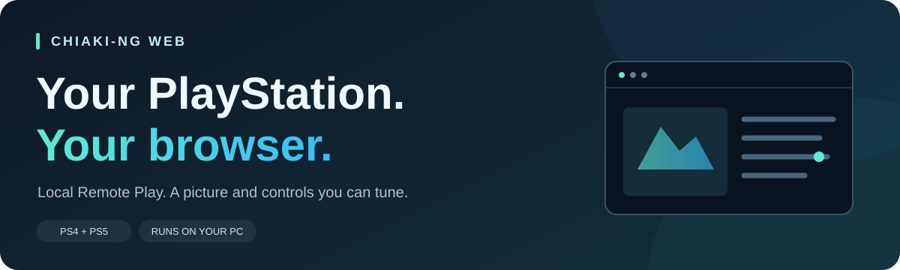
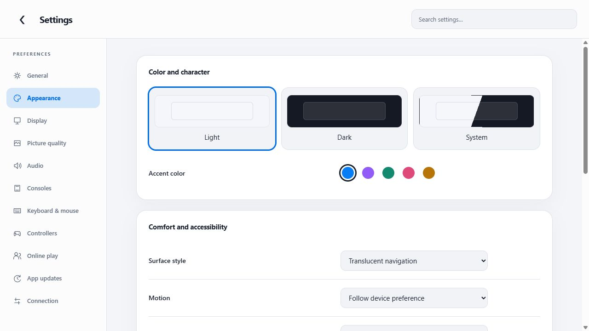
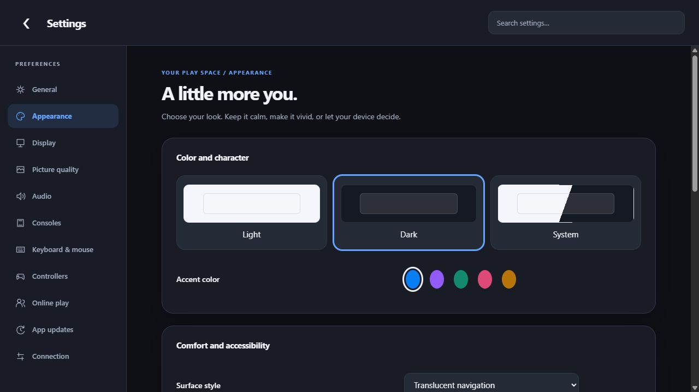
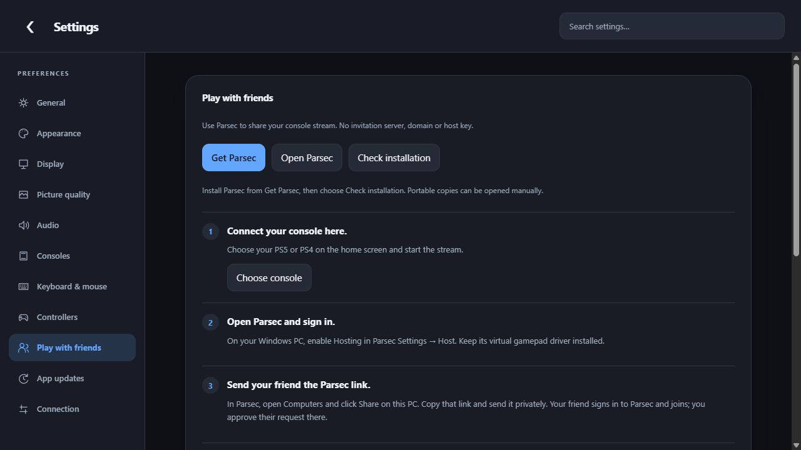

<p align="center">
  
</p>

<p align="center"><strong>Play your PS4 or PS5 on your PC, through a web browser.</strong><br>Your console runs the game. Your PC shows the picture and sends your controls back.</p>

<p align="center"><a href="https://github.com/SKIZZOO/Chiaki-NG-Web/releases/tag/browser-v1.14.0"><strong>Download for Windows</strong></a> · <a href="docs/GETTING_STARTED.md">Get started</a> · <a href="#take-a-look">Screenshots</a> · <a href="docs/USER_GUIDE.md">Controls &amp; settings</a></p>

<p align="center"><a href="https://github.com/SKIZZOO/Chiaki-NG-Web/actions/workflows/browser-relay.yml"></a></p>

## What is this?

Chiaki-NG Web is a free, open-source **Remote Play client**. It connects to your PlayStation so you can play from your PC with a controller, or keyboard and mouse. A small program runs on your PC while the interface opens in your browser.

Start with your **PC and PlayStation on the same home network**. The console must be on, with Remote Play enabled. An Ethernet cable is ideal for a steady picture.

| What you can do | Where to find it |
|---|---|
| Connect with a guided pairing screen | **+** on the home screen |
| Use a controller or a familiar keyboard/mouse layout | **Settings → Keyboard & mouse** |
| Choose clearer video or reduce noisy fog and dark scenes | **Settings → Picture quality** |
| See controls and live picture statistics | Press **backtick (`)** while streaming |
| Keep console addresses and IDs hidden | Hidden until you select **Show details** |

## Start here

### 1 · Set it up once

Follow the **[Windows first-time setup guide](docs/GETTING_STARTED.md)**. It explains what to install, which commands to copy, and what to expect on screen.

The **Windows installer** includes everything needed to run the browser edition. Install it, open **Chiaki-NG Web** from Start, and follow the first-run guide. No Git, Rust, Python or separate Node installation is needed. A portable ZIP is available too. This first installer release is an unsigned community preview for Windows 10/11 x64.

Using a Mac? See the [experimental macOS source setup](docs/MACOS_SETUP.md), including the launcher and trackpad controls.

Already comfortable with development tools? Use the [complete build and configuration guide](docs/BROWSER_SETUP.md).

### 2 · Pair your PlayStation

1. On PS5, open **Settings → System → Remote Play** and enable Remote Play.
2. Open **Pair Device / Link Device** and leave its code visible.
3. In Chiaki, press **+**, select your console or enter its local address, then follow the instructions. On PS4, use **Remote Play Connection Settings**.
4. Select the saved console to start playing.

Your **PSN username**, **account ID**, and **pairing code** are different things. The setup screen explains each one. The account ID is a technical identifier; you never enter your PSN password here. Automatic username lookup uses an external service; manual account-ID entry is also available.

### 3 · Open it next time

Open **Chiaki-NG Web** from the Start menu or desktop shortcut. Its tray icon keeps the local server running; choose **Quit and stop server** there when finished.

For a source-code checkout, run this in PowerShell from the project folder:

```powershell
.\scripts\run-web.ps1 -NoBuild -Port 8090
```

Keep that terminal open and visit **http://127.0.0.1:8090/**. That address means “this PC.” Closing the terminal stops the server.

## Take a look

A fresh interface with light, dark and system themes, searchable settings, and a floating stream toolbar. [Explore the interface and new settings →](docs/INTERFACE_GUIDE.md)

<table>
<tr>
<td width="50%" valign="top"><br><strong>A lighter space.</strong> Soft surfaces, clear controls and your choice of accent.</td>
<td width="50%" valign="top"><br><strong>Made for evenings.</strong> Dark surfaces with the same familiar layout.</td>
</tr>
</table>

These screenshots use a clean local preview with no saved console or account information.

## Make it look and feel right

**Start with a preset in Settings → Picture quality.** A higher bitrate lets the console send more picture data. It helps with compression, but the actual rate varies with what is happening on screen.

| Preset | Use it for | Requested video |
|---|---|---|
| **High quality LAN** | A clear everyday picture on a good home network | 1080p, 60 fps, H.265, 50 Mbps |
| **Clean fog / dark scenes** | Grainy fog, noisy shadows and dark gradients | 1080p, 60 fps, H.265, 80 Mbps; gentle sharpening and noise reduction |

Restart after changing bitrate or codec. Too much noise reduction can soften fine details. Press **`** to see the video bitrate actually arriving. [Picture troubleshooting →](docs/BROWSER_SETUP.md#picture-quality-and-fog-noise)

**For keyboard and mouse**, enable **Settings → Keyboard & mouse → PC keyboard + mouse controls**, then click the video to capture the cursor.

| Key | Action in the PC preset |
|---|---|
| **W A S D** / mouse | Move / look |
| **Left / right click** | Fire / aim |
| **Space / Shift** | Jump / sprint |
| **R / E** | Reload / interact |
| **B / N / P** | PS button / Share / Options |
| **F8** | Release or capture the mouse |
| **`** | Show or hide the controls sidebar |

Games still receive controller inputs, so their button layouts and maximum turn speed apply. Adjust mouse sensitivity and dead-zone compensation in Keyboard & mouse if movement feels too slow or jumpy.

## A few useful answers

<details>
<summary><strong>Does it run PlayStation games on the PC?</strong></summary>

Your PlayStation runs the game. This app streams its picture and sound to the PC and sends your controls back. Keep the console on and Remote Play enabled.

</details>

<details>
<summary><strong>Will it look like native 4K? What about frame generation?</strong></summary>

This client requests up to a 1080p stream. Sharpening and extra bitrate cannot recreate native 4K detail. Lossless Scaling can add displayed frames externally; activate it in your installed Windows app. The browser does not bundle or automatically enable that proprietary engine.

</details>

<details>
<summary><strong>What stays on my PC?</strong></summary>

Local configuration, saved registration details and account databases are not included in this repository. The home screen masks console addresses and IDs; Show details reveals them locally. PSN username lookup sends the entered public username to a third-party provider; use manual account-ID entry to avoid that lookup. Keep registration keys and pairing codes out of public screenshots.

</details>

<details>
<summary><strong>Can I use the Electron desktop app?</strong></summary>

Use the browser edition for now. The optional Electron 45.0.0 build is blocked because its bundled Node version predates the verified security fixes. See the [security audit](docs/SECURITY_AUDIT.md) for the exact versions and remaining exception.

</details>

## More help

- **[First-time setup](docs/GETTING_STARTED.md)** — a plain-language Windows walkthrough.
- **[Controls and every settings tab](docs/USER_GUIDE.md)** — the complete first-run guide.
- **[Windows installer](docs/WINDOWS_INSTALLER.md)** — installation, portable use, data storage and uninstall.
- **[Full browser guide](docs/BROWSER_SETUP.md)** — pairing, quality, controls and troubleshooting.
- **[Build instructions](wasm/Build_WASM.md)** — Windows and Linux build details.
- **[Security audit](docs/SECURITY_AUDIT.md)** — checked versions, dependencies and limitations.
- **[Privacy review](docs/PRIVACY_REVIEW.md)** — what was checked before publishing these pictures.
- **[Rust relay](wasm/relay-rust/README.md)** — architecture and developer checks.

The browser interface uses Chiaki’s C/WebAssembly streaming core, a Rust network relay and a Node server. This community fork builds on [CSystem77/Chiaki-NG-Web](https://github.com/CSystem77/Chiaki-NG-Web), [chiaki-ng](https://github.com/streetpea/chiaki-ng), and the original Chiaki by **~thestr4ng3r**. Upstream contributors retain their credit and licenses.

Released under the included [license](COPYING). This project is not affiliated with or endorsed by Sony Interactive Entertainment.


### Play with friends online

Open **Play with friends** for the Parsec setup: install/sign in, share this PC in Parsec, approve your friend, then return to the game. No server or domain is needed for this option. The app can open a standard Windows Parsec installation and lets you choose the controller used by the stream. [Easy Parsec guide →](docs/PARSEC_GUIDE.md)

Self-hosted browser invitations remain under **Advanced**, with their own [server setup guide](docs/ONLINE_PLAY.md).

<p align="center"></p>
