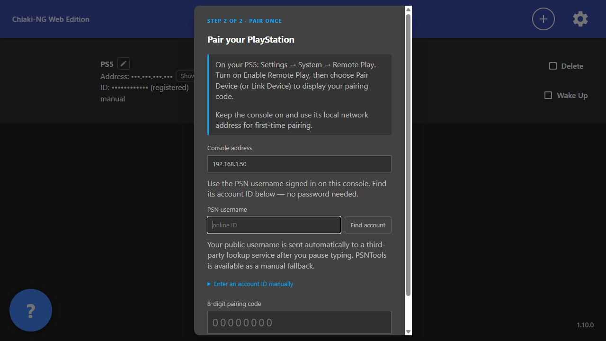

# Install and start playing

## Recommended: the Windows installer

1. Download **Chiaki-NG-Web-Setup-1.11.0-x64.exe** from the [Windows browser release](https://github.com/SKIZZOO/Chiaki-NG-Web/releases/tag/browser-v1.11.0).
2. Run it and follow the setup wizard. It installs for your Windows account; a desktop shortcut is optional.
3. Open **Chiaki-NG Web** from Start. Your browser opens and a first-run guide appears for a new browser profile.
4. Keep your PlayStation on and on the same network. Choose **Add a PlayStation**, then follow the pairing instructions.
5. Select your saved console to play. The **?** button always reopens the guide.

**Everything needed is included:** Node, the Rust relay and the compiled streaming core. You do not need development tools or a separate Node installation. The portable ZIP works by extracting all files and opening **Chiaki-NG Web.exe**.

This community preview is unsigned and targets Windows 10/11 x64. Download from this repository's release and compare the published SHA-256 checksums if needed.

### Next time

Open **Chiaki-NG Web** from Start. Keep its tray icon running while playing. Use the tray menu to reopen the browser or guide, or choose **Quit and stop server** when finished.

Close any development server already using port 8090 before switching to the installed app. Use the same browser profile to retain settings and pairings. Closing a tab releases its stream; a second stream can block the next connection.

### Learn the controls and settings

The [complete user guide](USER_GUIDE.md) explains all PC-preset keys, controller and touch input, mouse sensitivity, every settings tab, picture quality, Lossless Scaling and troubleshooting. It is also included offline inside the app.

[Installer details, data storage and uninstall](WINDOWS_INSTALLER.md) · [Advanced browser setup](BROWSER_SETUP.md)

## Prefer to build from source?

<details>
<summary>Show the developer setup instructions</summary>


This guide is for a **Windows PC** and a PS4 or PS5 on the same home network.
You will run a small server on the PC, open its page in a browser, and pair your
console. The PlayStation continues to run the game.

## Before you start

- Keep your PlayStation on and connected to the same router as the PC.
- Use Chrome or Edge with H.265 video support. A wired connection helps.
- Have the console's active PSN account details available for pairing.
- Leave some free disk space: first-time setup downloads development tools.

**This is a source-code project.** “Build” means turning those files into the
streaming component your browser can run. You do this once, then use one command
to start the app each day. A ready-to-run installer is not currently provided.

## 1. Install these tools once

Use the official installers:

| Tool | Why it is needed | What to choose |
|---|---|---|
| [Git for Windows](https://git-scm.com/downloads/win) | Downloads the project | Default installation options are sufficient |
| [Python](https://www.python.org/downloads/windows/) | Helps prepare the streaming build | Python 3.13 or newer; enable the option to add Python to PATH |
| [Visual Studio Build Tools](https://visualstudio.microsoft.com/downloads/#build-tools-for-visual-studio-2022) | Builds the networking component | Select **Desktop development with C++**, including **C++ CMake tools for Windows** |
| [Rust](https://www.rust-lang.org/tools/install) | Builds the Rust networking component | The default Windows MSVC toolchain |

Close and reopen your terminal after installing these. You do not need to
install the full Visual Studio editor. Node and npm are installed locally by
the project's setup command below.

## 2. Download the project

Open **PowerShell** from the Windows Start menu. Copy these commands into it:

```powershell
git clone https://github.com/SKIZZOO/Chiaki-NG-Web.git
cd Chiaki-NG-Web
git submodule update --init third-party/nanopb third-party/jerasure third-party/gf-complete
```

You are now inside the project folder. Run the rest of the commands there.

## 3. Prepare and build it

Copy this block into the same PowerShell window:

```powershell
.\scripts\install-node.ps1
git clone https://github.com/emscripten-core/emsdk.git .tools/emsdk
.\.tools\emsdk\emsdk install 6.0.13
.\.tools\emsdk\emsdk activate 6.0.13
.\scripts\build-wasm.ps1
.\scripts\run-web.ps1 -Port 8090
```

The first command installs the project's verified Node/npm versions into its
own tools folder. Emscripten builds the browser streaming component. The last
command builds the Rust relay and starts the server. Initial downloads and
compilation can take a while; wait for each command to finish.

When the terminal prints **http://127.0.0.1:8090/**, open that address in your
browser. **Keep the terminal open** while playing. The browser address points to
your own PC; there is no hosted demo to sign into.

If a command fails, stop at that command. Check the message before continuing.
The [full build guide](../wasm/Build_WASM.md) covers the toolchain in more detail.
If Windows blocks a script, review Microsoft's
[PowerShell execution policy documentation](https://learn.microsoft.com/powershell/module/microsoft.powershell.core/about/about_execution_policies)
before changing a policy. Do not disable system security protections to install this project.

## 4. Pair the PlayStation

**On PS5:** open **Settings → System → Remote Play**. Enable Remote Play, then
open **Pair Device / Link Device** and leave the code on screen.

**On PS4:** use **Settings → Remote Play Connection Settings → Add Device**.

**In the browser:**

1. Press **+** on the home screen.
2. Choose your nearby console, or type its local IP address. You can find that
   address in the console's network settings. It often starts with `192.168.` or `10.`.
3. Continue to pairing. Use the account belonging to the user active on the console.
4. Enter the fresh eight-digit code and select **Pair console**.

**Three different things:** your PSN username is your public online name; the
account ID is a technical identifier; the pairing code is the temporary number
shown by the console. You never need to give this app your PSN password.

Username lookup sends the entered public name to an external service. You can
instead expand **Enter an account ID manually** and supply an ID you already have.
If lookup is unavailable, manual entry still works.



The address in this picture is an example. Use your own console's address.

## 5. Start playing

Select your saved console. For a controller, connect it to the PC and press a
button so the browser can detect it.

For keyboard and mouse, enable **Settings → Keys → PC keyboard + mouse controls**,
then click the video. **WASD** moves, the mouse looks, and **F8** releases the cursor.
**B** is the PS button. **Backtick (`)** shows or hides the controls sidebar.
The exact action still depends on the game's controller layout.

For a clearer picture, open **Settings → Stream** and choose **High quality LAN**.
If fog or shadows are grainy, try **Clean fog / dark scenes**. Restart the stream
after changing bitrate. [More picture and mouse help →](BROWSER_SETUP.md)

## Next time: just start it

Open PowerShell in the project folder and run:

```powershell
.\scripts\run-web.ps1 -NoBuild -Port 8090
```

Then open **http://127.0.0.1:8090/** again. Your saved console remains available.
You only need to rebuild after updating the code or changing build dependencies.

## Something is not working?

| What you see | Try this |
|---|---|
| Browser cannot open the page | Check that the server terminal is still open and use the exact address it prints |
| Console is not found | Keep it on; check that PC and console use the same router; enter its local address manually |
| Pairing times out | Reopen the console's pairing screen and use its new code |
| Username lookup fails | Use manual account-ID entry; the lookup service can be unavailable |
| Another Remote Play app is connected | Disconnect that client, then try again |
| Picture stutters | Lower bitrate; check the console-to-PC network connection |
| Mouse feels jumpy | Lower dead-zone compensation in Settings → Keys |

For a useful bug report, describe the step that failed and the message shown.
Hide console addresses, IDs, PSN account IDs and pairing codes in screenshots.
Never attach `.env`, database files or exported registration keys.

</details>
